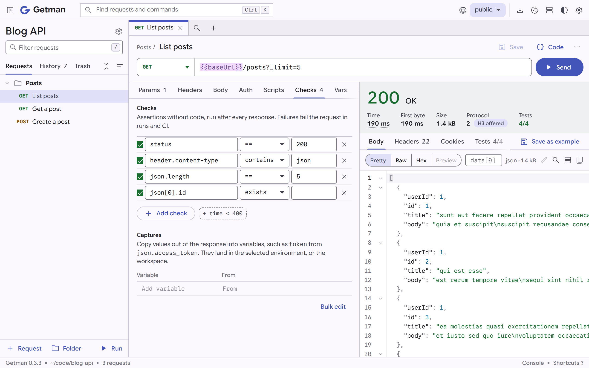

<p align="center">
  <picture>
    <source media="(prefers-color-scheme: dark)" srcset="docs/images/getman-dark.png">
    
  </picture>
</p>

# Getman: alternatif Postman yang sangat cepat, ditulis dengan Rust

[](https://github.com/fzn0x/getman/actions/workflows/ci.yml)
[](https://fzn0x.github.io/getman/)
[](#lisensi)

Getman adalah API client yang local-first, offline-first, dan open source. Getman mendukung **HTTP/1.1, HTTP/2 dan HTTP/3, gRPC, WebSocket, Server-Sent Events dan Socket.IO**, dan **kompatibel dengan Postman**: Getman bisa membuka Postman collection dan menjalankan script `pm`. Pakai Getman sebagai **aplikasi desktop**, di **browser**, di **terminal**, atau dari **CLI di CI**. Request kamu adalah file YAML biasa di dalam repository kamu.

**Tanpa akun. Tanpa cloud. Tanpa telemetry.**

[Unduh](#install) · [Dokumentasi](https://fzn0x.github.io/getman/) ·
[Rilis](https://github.com/fzn0x/getman/releases) ·
[Pindah dari Postman](docs/why-getman.md#moving-over)

```sh
getman init --example   # sebuah workspace dengan contoh request
getman                  # buka di browser kamu
getman tui              # atau di terminal
getman run              # atau jalankan semua request, untuk CI
```

## Kenapa Getman, bukan Postman

- **Tanpa akun, selamanya.** Menyimpan request, environment, variable, script, runner, dan history semuanya jalan offline. Postman mengharuskan kamu login ke sebuah workspace untuk menyimpan ke collection atau memakai environment.
- **Request kamu tinggal bersama kode kamu.** Satu file YAML pendek per request, bisa di-review di pull request dan ikut ter-versioning bersama API yang dipanggilnya. Token dan nilai pribadi masuk ke file `*.local.yaml` yang diabaikan git, jadi sisanya selalu aman untuk di-commit.
- **Gratis untuk tim sebesar apa pun.** Kamu berbagi workspace dengan cara me-commit-nya. Tidak ada biaya per pengguna, dan tidak ada paket berbayar untuk kolaborasi tim.
- **Desktop, browser, terminal, dan CI.** Aplikasi desktop native yang memperbarui dirinya sendiri dari rilis yang ditandatangani, UI browser, UI terminal untuk sesi SSH, dan runner CI, semuanya dari kode yang sama. Command line-nya adalah satu file kecil tanpa runtime yang perlu di-install, lihat [Cepat](#cepat).
- **Semua protokol yang kamu uji.** HTTP/1.1, HTTP/2 dan HTTP/3 (QUIC), gRPC dari file `.proto` atau server reflection, WebSocket, Server-Sent Events dan Socket.IO, berdampingan dalam satu workspace.
- **Tes tanpa kode.** Check seperti `status == 200` dan `json.data[0].id exists` hanyalah baris di dalam file request. Script tersedia kalau kamu membutuhkannya.
- **Kompatibel dengan Postman.** `getman import` membaca Postman collection, environment, dan globals, dan `getman export` menuliskannya kembali. `pm` adalah alias dari API script `gm` milik Getman, jadi sebagian besar script jalan tanpa diubah.
- **Mock dan AI agent, secara lokal.** `getman mock` menyajikan response yang tersimpan sebagai mock API, dan `getman mcp` memungkinkan AI agent memakai request kamu lewat Model Context Protocol, dengan secret yang disamarkan.
- **Open source**, di bawah MIT atau Apache-2.0.

Postman masih bisa lebih banyak: MQTT, hosted mock dan monitor, dan kolaborasi real-time. [Perbandingan lengkap](docs/why-getman.md) menautkan halaman Postman sendiri untuk setiap klaim dan menjelaskan kapan sebaiknya tetap di Postman.

## Cepat

Diukur di Windows 11 x64 dengan file rilis 0.3.0, pada 28 Oktober 2026:

| | |
| --- | --- |
| Perintah `getman`, UI browser termasuk di dalamnya | 9,5 MiB untuk diunduh, 25,6 MiB di disk |
| Waktu start-up `getman` | 7 ms |
| Server UI browser, saat idle | 2 MiB memori |
| Setup aplikasi desktop, perintah `getman` termasuk | 15,2 MiB |
| Aplikasi desktop, dari launch sampai jendela termuat | 0,45 detik, 0,8 detik untuk pertama kali |
| Aplikasi desktop, saat idle | 94 MiB memori: 5 MiB adalah Getman, sisanya WebView2 milik sistem |

Memori adalah private working set, yang ditampilkan Task Manager. Angkanya berbeda-beda tergantung sistem dan workspace.

## Install

### Aplikasi desktop

Getman di jendelanya sendiri, dengan perintah `getman` termasuk di dalamnya:

| Sistem | Unduh |
| --- | --- |
| Windows x64 | [Setup](https://github.com/fzn0x/getman/releases/latest/download/Getman-windows-x64-setup.exe) · [MSI](https://github.com/fzn0x/getman/releases/latest/download/Getman-windows-x64.msi) · [Portable zip](https://github.com/fzn0x/getman/releases/latest/download/Getman-windows-x64-portable.zip) |
| Windows ARM64 | [Setup](https://github.com/fzn0x/getman/releases/latest/download/Getman-windows-arm64-setup.exe) · [MSI](https://github.com/fzn0x/getman/releases/latest/download/Getman-windows-arm64.msi) · [Portable zip](https://github.com/fzn0x/getman/releases/latest/download/Getman-windows-arm64-portable.zip) |
| macOS (Apple silicon dan Intel) | [Disk image](https://github.com/fzn0x/getman/releases/latest/download/Getman-macos-universal.dmg) |
| Linux x86_64 | [AppImage](https://github.com/fzn0x/getman/releases/latest/download/Getman-linux-x86_64.AppImage) · [.deb](https://github.com/fzn0x/getman/releases/latest/download/getman-desktop_amd64.deb) · [.rpm](https://github.com/fzn0x/getman/releases/latest/download/getman-desktop.x86_64.rpm) |
| Linux ARM64 | [AppImage](https://github.com/fzn0x/getman/releases/latest/download/Getman-linux-aarch64.AppImage) · [.deb](https://github.com/fzn0x/getman/releases/latest/download/getman-desktop_arm64.deb) · [.rpm](https://github.com/fzn0x/getman/releases/latest/download/getman-desktop.aarch64.rpm) |

- **Windows:** jalankan setup-nya. Instalasi berlaku untuk user kamu, tanpa hak administrator, dan menambahkan `getman` ke `PATH` kamu. Kalau Windows menampilkan "Windows protected your PC", pilih **More info**, lalu **Run anyway**.
- **macOS:** buka disk image dan seret Getman ke Applications. Saat pertama kali, macOS tidak bisa memverifikasinya: buka **System Settings › Privacy & Security** dan klik **Open Anyway**. **Settings › About** di dalam aplikasi akan meng-install perintah `getman`.
- **Linux:** `chmod +x` AppImage lalu jalankan, atau install paketnya dengan `sudo apt install ./getman-desktop_amd64.deb` atau `sudo dnf install ./getman-desktop.x86_64.rpm`, yang juga menaruh `getman` di `/usr/bin`.

Aplikasi memeriksa versi baru sekali sehari, dan kamu bisa mematikannya. Lihat [Aplikasi desktop](docs/desktop.md) untuk detailnya.

### Command line

Linux dan macOS:

```sh
curl -fsSL https://fzn0x.github.io/getman/install.sh | sh
```

Windows (PowerShell):

```powershell
irm https://fzn0x.github.io/getman/install.ps1 | iex
```

Script tersebut mengunduh rilis terbaru untuk sistem kamu, memverifikasi checksum SHA-256-nya, dan meng-install `getman` hanya untuk user kamu. Kamu juga bisa mengunduh archive dari [halaman rilis](https://github.com/fzn0x/getman/releases), atau [build dari source](#build-dari-source).

## Request adalah file

```text
api/
  getman.yaml               pengaturan untuk semua request
  environments/
    staging.yaml            nilai yang dipakai bersama
    staging.local.yaml      secret kamu (diabaikan git)
  orders/
    _folder.yaml            auth, header, dan script untuk folder ini
    create-order.yaml
```

```yaml
# api/orders/create-order.yaml
name: Create order
method: POST
url: "{{baseUrl}}/orders"
body:
  type: json
  content: |
    { "sku": "BOOK-42", "quantity": 1 }
checks:
  - status == 201
  - json.id exists
  - time < 500
captures:
  orderId: json.id
```

Field yang memakai nilai default tidak ditulis, jadi diff tetap kecil. Folder dan workspace meneruskan header, authentication, variable, script, dan pengaturan ke request di dalamnya. Lihat [Workspaces](docs/workspaces.md).

## Fitur

**Protokol**

- **HTTP/1.1, HTTP/2 dan HTTP/3.** Pilih versinya per request atau per folder, atau biarkan Getman menegosiasikannya; ada petunjuk saat server menawarkan HTTP/3. Body JSON, XML, teks, form, multipart dengan file, binary, dan GraphQL. Lihat [HTTP dan koneksi](docs/http.md).
- **gRPC.** Panggilan unary, server streaming, client streaming, dan bidirectional streaming, dengan skema dari file `.proto` di workspace kamu atau dari server reflection, metadata, deadline, TLS, detail status yang ter-decode, dan satu request per method yang dibuat dari sebuah service. Lihat [gRPC](docs/grpc.md).
- **WebSocket, Server-Sent Events dan Socket.IO.** Terhubung, kirim pesan yang tersimpan atau yang disusun, dan pantau log live yang bisa dicari. Lihat [WebSocket, SSE dan Socket.IO](docs/realtime.md).

**Authentication**

- Basic, Bearer, API key, Digest (MD5, SHA-256, SHA-512-256), OAuth 2.0 (authorization code dengan PKCE, implicit, client credentials, password, refresh token, sign-in di browser kamu), OAuth 1.0a, AWS Signature Version 4, JWT, Atlassian ASAP, Hawk dan Akamai EdgeGrid, diwariskan dari folder. Lihat [Authentication](docs/auth.md).

**Koneksi**

- Proxy (HTTP, HTTPS, SOCKS5), client certificate (PEM atau PKCS#12), CA certificate tambahan, dan cookie jar yang tersimpan antar run dan bisa kamu edit.
- Ke mana waktu tiap response pergi: DNS, connect dan TLS, first byte dan download, beserta versi TLS dan sertifikat server.
- Batalkan request apa pun selagi masih berjalan.

**Aplikasi**

- **Aplikasi desktop** untuk Windows, macOS dan Linux, di x64 dan ARM64, yang memperbarui dirinya sendiri dari rilis yang ditandatangani. Lihat [Aplikasi desktop](docs/desktop.md).
- **UI browser yang mengutamakan keyboard.** Tab dan draft yang bertahan setelah restart, command palette (<kbd>Ctrl</kbd> <kbd>K</kbd>), kirim dengan <kbd>Ctrl</kbd> <kbd>Enter</kbd>, `{{variables}}` yang di-highlight dan dilengkapi di mana-mana dengan nilainya saat di-hover, filter JSON path dan hex view pada response, history yang menyimpan tiap response, trash dengan undo, dan tema terang dan gelap. Lihat [Browser UI](docs/browser-ui.md).
- **UI terminal** untuk saat tidak ada jendela sama sekali.

**Tes dan automasi**

- **Check dan capture** tanpa kode, dan **script** di mesin JavaScript yang tertanam: library assertion yang ekspresif, JSON Schema, `sendRequest`, helper crypto, dan kontrol run.
- **Runner** dengan iterasi, file data CSV dan JSON, delay dan bail, di UI dan sebagai `getman run`, dengan laporan CLI, JSON, JUnit, HTML, CSV dan Excel. UI menyimpan 20 run terakhir.
- **Variable dengan aturan yang jelas.** Scope global, workspace, environment, folder, request, data, dan local, lebih dari 30 nilai dinamis seperti `{{$uuid}}`, dan secret dari environment variable `GETMAN_*`.
- **Contoh dan mock.** Simpan response sebagai contoh pada sebuah request dan sajikan dengan `getman mock`. Lihat [Contoh dan mock](docs/examples-and-mocks.md).
- **AI agent.** `getman mcp` menyajikan workspace lewat Model Context Protocol ke Claude Code, Claude Desktop, dan agent lain. Lihat [AI agent](docs/mcp.md).

**Import dan export**

- **Import** Postman collection, environment dan globals, OpenAPI 3 dan Swagger 2, file HAR dari browser kamu, collection Insomnia, Hoppscotch dan Bruno, serta perintah cURL. Seret file ke jendela.
- **Export** folder sebagai Postman collection atau OpenAPI 3.1, environment sebagai Postman environment, dan request apa pun sebagai kode: cURL, HTTPie, Wget, PowerShell, raw HTTP, fetch, axios, Node.js, Python, Go, Rust, Java, Kotlin, C#, Swift, PHP, Ruby dan Dart, atau grpcurl untuk gRPC, dengan `{{variables}}` yang dipertahankan supaya tidak ada token yang bocor ke dalam snippet.

## Jalankan di CI

```yaml
# .github/workflows/api.yml
- name: Install Getman
  run: |
    curl -fsSL https://fzn0x.github.io/getman/install.sh | sh
    echo "$HOME/.local/bin" >> "$GITHUB_PATH"
- name: Run the API checks
  run: getman run -w api -e staging -r cli -r junit=getman.xml
  env:
    GETMAN_API_TOKEN: ${{ secrets.API_TOKEN }}
```

```text
Orders API with the staging environment: 3 requests

  ✓ POST    Create order   201 Created 182 ms · 96 B
  ✗ GET     Get order      404 Not Found 41 ms · 23 B
      ✗ status == 200
        status is 404; expected == 200
  ✓ DELETE  Archive order  204 No Content 37 ms · 0 B
```

`getman run` keluar dengan kode 1 saat sebuah request gagal, dan 2 saat tidak bisa mulai. Lihat [Menjalankan di CI](docs/runner.md).

## Keamanan

UI browser disajikan oleh Getman hanya di `127.0.0.1`. Server menolak request yang ditujukan ke host name lain (DNS rebinding) atau yang dikirim dari halaman web lain, dan setiap panggilan API butuh token acak yang hanya dibawa oleh link dari terminal kamu. Request hanya bisa meng-upload file dari dalam workspace, dan `{{$env.…}}` hanya membaca variable yang diawali `GETMAN_`. Pengecekan update harian aplikasi desktop adalah satu-satunya request yang dibuat Getman atas inisiatifnya sendiri, dan kamu bisa mematikannya. Lihat [Keamanan dan privasi](docs/security.md), dan [SECURITY.md](SECURITY.md) untuk melaporkan kerentanan.

## Dokumentasi

- [Memulai](docs/id/getting-started.md) ·
  [Aplikasi desktop](docs/desktop.md) ·
  [Kenapa Getman](docs/why-getman.md), dan pindah dari Postman
- [Workspaces](docs/workspaces.md) ·
  [Variable dan environment](docs/variables.md) ·
  [Authentication](docs/auth.md) ·
  [Check dan capture](docs/checks.md) · [Script](docs/scripts.md)
- [HTTP dan koneksi](docs/http.md) ·
  [WebSocket, SSE dan Socket.IO](docs/realtime.md) · [gRPC](docs/grpc.md)
- [Menjalankan di CI](docs/runner.md) ·
  [Contoh dan mock](docs/examples-and-mocks.md) ·
  [AI agent](docs/mcp.md) · [Import dan export](docs/import-export.md)
- [Browser UI](docs/browser-ui.md) · [Terminal UI](docs/terminal.md) ·
  [Command line](docs/cli.md) · [Keamanan dan privasi](docs/security.md)

## Build dari source

Kamu butuh [Rust](https://rustup.rs) 1.88 atau lebih baru dan
[Node.js](https://nodejs.org) 22.12 atau lebih baru. UI browser di-build
dulu, karena tertanam di dalam binary.

```sh
git clone https://github.com/fzn0x/getman.git
cd getman/web
npm ci
npm run build
cd ..
cargo install --path crates/getman
```

Aplikasi desktop butuh Rust 1.90 atau lebih baru dan, di Linux, WebKitGTK; jalankan dengan `cargo run -p getman-desktop`. [CONTRIBUTING.md](CONTRIBUTING.md) menjelaskan cara build installer-nya.

### Tata letak proyek

| Path | |
| --- | --- |
| `crates/getman-core` | Mesinnya: file workspace, variable, HTTP, gRPC, WebSocket, SSE dan Socket.IO, auth, check, script, runner, import dan export |
| `crates/getman` | Perintah `getman`: command line, server lokal, UI terminal, reporter, mock server dan MCP server |
| `crates/getman-desktop` | Aplikasi desktop, dengan Tauri, dan update-nya |
| `web` | UI browser: Svelte 5, TypeScript dan CodeMirror 6 |
| `site` | Dokumentasi ini sebagai website, diterbitkan ke GitHub Pages |
| `docs` | Halaman-halaman dokumentasi |

### Pengujian

```sh
cargo test --workspace
cargo clippy --workspace --all-targets -- --deny warnings
cd web && npm run check && npm test
```

CI menjalankan semua ini di Linux, Windows dan macOS, melakukan smoke test pada command line, dan memeriksa versi Rust minimum yang didukung. Lihat [CONTRIBUTING.md](CONTRIBUTING.md). Perubahan di tiap rilis ada di [CHANGELOG.md](CHANGELOG.md), dan semua yang ikut serta mengikuti [Code of Conduct](CODE_OF_CONDUCT.md).

## Lisensi

Dilisensikan di bawah [Apache License, Version 2.0](LICENSE-APACHE) atau [lisensi MIT](LICENSE-MIT), sesuai pilihan kamu. Kontribusi diterima dengan syarat yang sama. Font Departure Mono di `web/public/fonts` berada di bawah SIL Open Font License, lihat file lisensinya di sana.

Postman adalah trademark dari Postman, Inc. Getman tidak berafiliasi dengan atau didukung oleh Postman.
