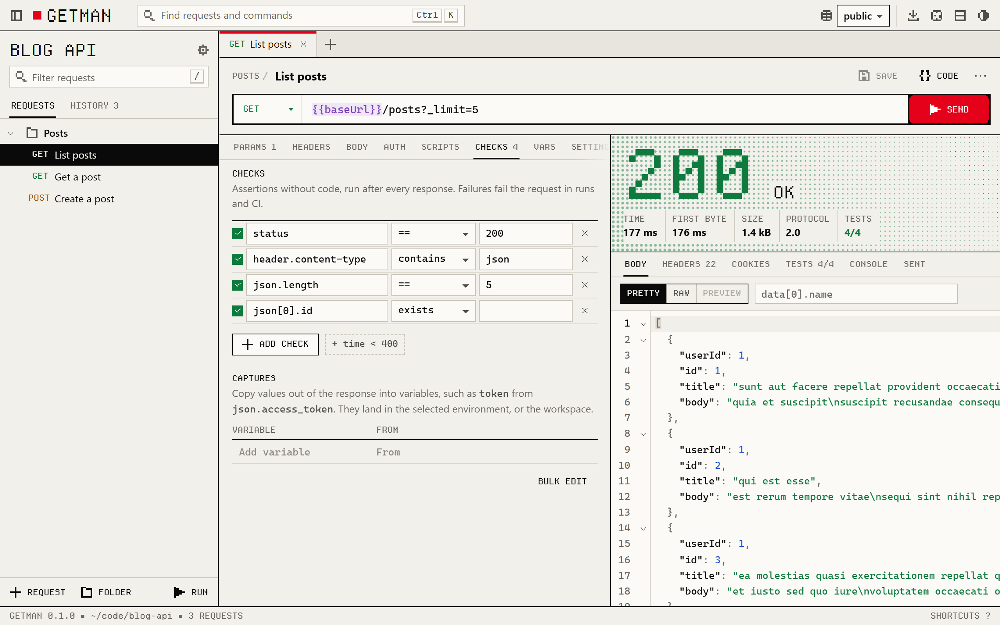

<p align="center">
  <picture>
    <source media="(prefers-color-scheme: dark)" srcset="docs/images/getman-dark.png">
    
  </picture>
</p>

# Getman: blazing fast Postman alternative in Rust

[](https://github.com/fzn0x/getman/actions/workflows/ci.yml)
[](https://fzn0x.github.io/getman/)
[](#license)

Getman is a local-first, offline-first, open-source API client. It
speaks **HTTP/1.1, HTTP/2 and HTTP/3, gRPC, WebSocket, Server-Sent Events
and Socket.IO**, and it is **Postman compatible**: it opens Postman
collections and runs `pm` scripts. Use it as a **desktop app**, in your
**browser**, in the **terminal**, or from the **CLI in CI**. Your requests
are plain YAML files in your repository.

**No account. No cloud. No telemetry.**

[Download](#install) · [Documentation](https://fzn0x.github.io/getman/) ·
[Releases](https://github.com/fzn0x/getman/releases) ·
[Moving from Postman](docs/why-getman.md#moving-over)

```sh
getman init --example   # a workspace with example requests
getman                  # open it in your browser
getman tui              # or in the terminal
getman run              # or run every request, for CI
```

## Why Getman over Postman

- **No account, ever.** Saving requests, environments, variables, scripts,
  the runner and history all work offline. Postman needs you signed in to
  a workspace to save to collections or use environments.
- **Your requests live with your code.** One short YAML file per request,
  reviewed in pull requests and versioned with the API it calls. Tokens
  and personal values go in git-ignored `*.local.yaml` files, so the rest
  is always safe to commit.
- **Free for any team.** You share a workspace by committing it. There are
  no seats, and no paid plan for teams to collaborate.
- **Desktop, browser, terminal and CI.** A native desktop app that updates
  itself from signed releases, a browser UI, a terminal UI for SSH
  sessions, and a CI runner, all from the same code. The command line is
  one small file with no runtime to install; see [Fast](#fast).
- **Every protocol you test.** HTTP/1.1, HTTP/2 and HTTP/3 (QUIC), gRPC
  from `.proto` files or server reflection, WebSocket, Server-Sent Events
  and Socket.IO, side by side in one workspace.
- **Tests without code.** Checks such as `status == 200` and
  `json.data[0].id exists` are lines in the request file. Scripts are
  there when you need them.
- **Postman compatible.** `getman import` reads Postman collections,
  environments and globals, and `getman export` writes them back. `pm` is
  an alias of Getman's `gm` script API, so most scripts run unchanged.
- **Mocks and AI agents, locally.** `getman mock` serves saved responses
  as a mock API, and `getman mcp` lets AI agents use your requests over
  the Model Context Protocol, with secrets masked.
- **Open source**, under MIT or Apache-2.0.

Postman still does more: MQTT, hosted mocks and monitors, and real-time
collaboration. The [full comparison](docs/why-getman.md) links Postman's
own pages for every claim and says when to stay.

## Fast

Measured on Windows 11 x64 with the release builds, on 28 October 2026:

| | |
| --- | --- |
| `getman` command, browser UI included | 10.0 MiB to download, 25.7 MiB on disk |
| `getman` start-up | 8 ms |
| Browser UI server, idle | 10 MiB of memory |
| Desktop app setup, `getman` command included | 15.5 MiB |
| Desktop app, launch to a loaded window | 0.45 to 0.6 s |
| Desktop app, idle | 94 MiB of memory: 5 MiB is Getman, the rest the system's WebView2 |

Memory is the private working set, which Task Manager shows. Numbers vary
with the system and the workspace.

## Install

### Desktop app

Getman in its own window, with the `getman` command included:

| System | Download |
| --- | --- |
| Windows x64 | [Setup](https://github.com/fzn0x/getman/releases/latest/download/Getman-windows-x64-setup.exe) · [MSI](https://github.com/fzn0x/getman/releases/latest/download/Getman-windows-x64.msi) · [Portable zip](https://github.com/fzn0x/getman/releases/latest/download/Getman-windows-x64-portable.zip) |
| Windows ARM64 | [Setup](https://github.com/fzn0x/getman/releases/latest/download/Getman-windows-arm64-setup.exe) · [MSI](https://github.com/fzn0x/getman/releases/latest/download/Getman-windows-arm64.msi) · [Portable zip](https://github.com/fzn0x/getman/releases/latest/download/Getman-windows-arm64-portable.zip) |
| macOS (Apple silicon and Intel) | [Disk image](https://github.com/fzn0x/getman/releases/latest/download/Getman-macos-universal.dmg) |
| Linux x86_64 | [AppImage](https://github.com/fzn0x/getman/releases/latest/download/Getman-linux-x86_64.AppImage) · [.deb](https://github.com/fzn0x/getman/releases/latest/download/getman-desktop_amd64.deb) · [.rpm](https://github.com/fzn0x/getman/releases/latest/download/getman-desktop.x86_64.rpm) |
| Linux ARM64 | [AppImage](https://github.com/fzn0x/getman/releases/latest/download/Getman-linux-aarch64.AppImage) · [.deb](https://github.com/fzn0x/getman/releases/latest/download/getman-desktop_arm64.deb) · [.rpm](https://github.com/fzn0x/getman/releases/latest/download/getman-desktop.aarch64.rpm) |

- **Windows:** run the setup. It installs for your user, without
  administrator rights, and adds `getman` to your `PATH`. If Windows says
  "Windows protected your PC", choose **More info**, then **Run anyway**.
- **macOS:** open the disk image and drag Getman to Applications. The
  first time, macOS cannot verify it: open **System Settings › Privacy &
  Security** and click **Open Anyway**. **Settings › About** in the app
  installs the `getman` command.
- **Linux:** `chmod +x` the AppImage and run it, or install a package
  with `sudo apt install ./getman-desktop_amd64.deb` or
  `sudo dnf install ./getman-desktop.x86_64.rpm`, which also puts
  `getman` in `/usr/bin`.

The app checks once a day for a new version, which you can turn off. See
[Desktop app](docs/desktop.md) for the details.

### Command line

Linux and macOS:

```sh
curl -fsSL https://fzn0x.github.io/getman/install.sh | sh
```

Windows (PowerShell):

```powershell
irm https://fzn0x.github.io/getman/install.ps1 | iex
```

The scripts download the latest release for your system, verify its
SHA-256 checksum and install `getman` for your user only. You can also
download an archive from the [releases page](https://github.com/fzn0x/getman/releases),
or [build from source](#building-from-source).

## Requests are files

```text
api/
  getman.yaml               settings for every request
  environments/
    staging.yaml            shared values
    staging.local.yaml      your secrets (git-ignored)
  orders/
    _folder.yaml            auth, headers and scripts for the folder
    create-order.yaml
```

```yaml
# api/orders/create-order.yaml
name: Create order
method: POST
url: "{{baseUrl}}/orders"
body:
  type: json
  content: |
    { "sku": "BOOK-42", "quantity": 1 }
checks:
  - status == 201
  - json.id exists
  - time < 500
captures:
  orderId: json.id
```

Fields at their defaults are not written, so diffs stay small. Folders
and the workspace pass headers, authentication, variables, scripts and
settings down to the requests inside them. See
[Workspaces](docs/workspaces.md).

## Features

**Protocols**

- **HTTP/1.1, HTTP/2 and HTTP/3.** Choose the version per request or
  folder, or let Getman negotiate it; a hint shows when a server offers
  HTTP/3. JSON, XML, text, forms, multipart with files, binary and
  GraphQL bodies. See [HTTP and connections](docs/http.md).
- **gRPC.** Unary, server, client and bidirectional streaming calls, with
  schemas from `.proto` files in your workspace or from server reflection,
  metadata, deadlines, TLS, decoded status details, and one request per
  method generated from a service. See [gRPC](docs/grpc.md).
- **WebSocket, Server-Sent Events and Socket.IO.** Connect, send saved or
  composed messages, and watch a live, searchable log. See
  [WebSocket, SSE and Socket.IO](docs/realtime.md).

**Authentication**

- Basic, Bearer, API key, Digest (MD5, SHA-256, SHA-512-256), OAuth 2.0
  (authorization code with PKCE, implicit, client credentials, password,
  refresh tokens, sign-in in your browser), OAuth 1.0a, AWS Signature
  Version 4, JWT, Atlassian ASAP, Hawk and Akamai EdgeGrid, inherited from
  folders. See [Authentication](docs/auth.md).

**Connections**

- Proxies (HTTP, HTTPS, SOCKS5), client certificates (PEM or PKCS#12),
  extra CA certificates, and a cookie jar kept between runs that you can
  edit.
- Where each response's time went: DNS, connect and TLS, first byte and
  download, with the TLS version and the server's certificate.
- Cancel any request while it is on its way.

**Apps**

- **A desktop app** for Windows, macOS and Linux, on x64 and ARM64, that
  updates itself from signed releases. See [Desktop app](docs/desktop.md).
- **A keyboard-first browser UI.** Tabs and drafts that survive a restart,
  a command palette (<kbd>Ctrl</kbd> <kbd>K</kbd>), send with
  <kbd>Ctrl</kbd> <kbd>Enter</kbd>, `{{variables}}` highlighted and
  completed everywhere with their values on hover, a JSON path filter and
  hex view on responses, history that keeps each response, a trash with
  undo, and light and dark themes. See [Browser UI](docs/browser-ui.md).
- **A terminal UI** for when there is no window at all.

**Tests and automation**

- **Checks and captures** without code, and **scripts** in an embedded
  JavaScript engine: an expressive assertion library, JSON Schema,
  `sendRequest`, crypto helpers and run control.
- **A runner** with iterations, CSV and JSON data files, delays and bail,
  in the UI and as `getman run`, with CLI, JSON, JUnit, HTML, CSV and Excel
  reports. The UI keeps the last 20 runs.
- **Variables with clear rules.** Globals, workspace, environment,
  folder, request, data and local scopes, more than 30 dynamic values
  such as `{{$uuid}}`, and secrets from `GETMAN_*` environment variables.
- **Examples and mocks.** Save responses as examples on a request and
  serve them with `getman mock`. See [Examples and mocks](docs/examples-and-mocks.md).
- **AI agents.** `getman mcp` serves the workspace over the Model Context
  Protocol to Claude Code, Claude Desktop and other agents. See
  [AI agents](docs/mcp.md).

**Import and export**

- **Import** Postman collections, environments and globals, OpenAPI 3
  and Swagger 2, HAR files from your browser, Insomnia, Hoppscotch and
  Bruno collections, and cURL commands. Drop files onto the window.
- **Export** folders as Postman collections or OpenAPI 3.1, environments
  as Postman environments, and any request as code: cURL, HTTPie, Wget,
  PowerShell, raw HTTP, fetch, axios, Node.js, Python, Go, Rust, Java,
  Kotlin, C#, Swift, PHP, Ruby and Dart, or grpcurl for gRPC, with
  `{{variables}}` kept so no token leaks into a snippet.

## Run it in CI

```yaml
# .github/workflows/api.yml
- name: Install Getman
  run: |
    curl -fsSL https://fzn0x.github.io/getman/install.sh | sh
    echo "$HOME/.local/bin" >> "$GITHUB_PATH"
- name: Run the API checks
  run: getman run -w api -e staging -r cli -r junit=getman.xml
  env:
    GETMAN_API_TOKEN: ${{ secrets.API_TOKEN }}
```

```text
Orders API with the staging environment: 3 requests

  ✓ POST    Create order   201 Created 182 ms · 96 B
  ✗ GET     Get order      404 Not Found 41 ms · 23 B
      ✗ status == 200
        status is 404; expected == 200
  ✓ DELETE  Archive order  204 No Content 37 ms · 0 B
```

`getman run` exits with 1 when a request fails, and 2 when it cannot
start. See [Running in CI](docs/runner.md).

## Security

The browser UI is served by Getman on `127.0.0.1` only. The server
refuses requests addressed to other host names (DNS rebinding) or sent
from other web pages, and every API call needs a random token that only
the link from your terminal carries. Requests can upload files only from
inside the workspace, and `{{$env.…}}` reads only variables that start
with `GETMAN_`. The desktop app's daily update check is the only request
Getman makes on its own, and you can turn it off. See
[Security and privacy](docs/security.md), and [SECURITY.md](SECURITY.md)
to report a vulnerability.

## Documentation

- [Getting started](docs/getting-started.md) ·
  [Desktop app](docs/desktop.md) ·
  [Why Getman](docs/why-getman.md), and moving over from Postman
- [Workspaces](docs/workspaces.md) ·
  [Variables and environments](docs/variables.md) ·
  [Authentication](docs/auth.md) ·
  [Checks and captures](docs/checks.md) · [Scripts](docs/scripts.md)
- [HTTP and connections](docs/http.md) ·
  [WebSocket, SSE and Socket.IO](docs/realtime.md) · [gRPC](docs/grpc.md)
- [Running in CI](docs/runner.md) ·
  [Examples and mocks](docs/examples-and-mocks.md) ·
  [AI agents](docs/mcp.md) · [Import and export](docs/import-export.md)
- [Browser UI](docs/browser-ui.md) · [Terminal UI](docs/terminal.md) ·
  [Command line](docs/cli.md) · [Security and privacy](docs/security.md)

## Building from source

You need [Rust](https://rustup.rs) 1.88 or newer and
[Node.js](https://nodejs.org) 22.12 or newer. The browser UI is built
first, because it is embedded in the binary.

```sh
git clone https://github.com/fzn0x/getman.git
cd getman/web
npm ci
npm run build
cd ..
cargo install --path crates/getman
```

The desktop app needs Rust 1.90 or newer and, on Linux, WebKitGTK; run
it with `cargo run -p getman-desktop`. [CONTRIBUTING.md](CONTRIBUTING.md)
explains building its installers.

### Project layout

| Path | |
| --- | --- |
| `crates/getman-core` | The engine: workspace files, variables, HTTP, gRPC, WebSocket, SSE and Socket.IO, auth, checks, scripts, the runner, import and export |
| `crates/getman` | The `getman` command: command line, local server, terminal UI, reporters, mock server and MCP server |
| `crates/getman-desktop` | The desktop app, with Tauri, and its updates |
| `web` | The browser UI: Svelte 5, TypeScript and CodeMirror 6 |
| `site` | This documentation as a website, published to GitHub Pages |
| `docs` | The documentation pages |

### Testing

```sh
cargo test --workspace
cargo clippy --workspace --all-targets -- --deny warnings
cd web && npm run check && npm test
```

CI runs these on Linux, Windows and macOS, smoke-tests the command line,
and checks the minimum supported Rust version. See [CONTRIBUTING.md](CONTRIBUTING.md).

## License

Licensed under either of the [Apache License, Version 2.0](LICENSE-APACHE)
or the [MIT license](LICENSE-MIT), at your option. Contributions are
accepted under the same terms. The Departure Mono font in `web/public/fonts`
is under the SIL Open Font License; see its licence file there.

Postman is a trademark of Postman, Inc. Getman is not affiliated with or
endorsed by Postman.
