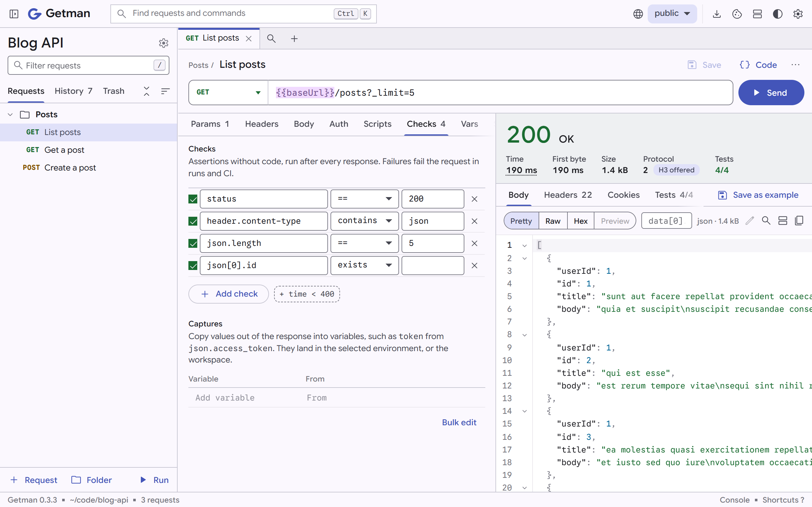

<p align="center">
  <picture>
    <source media="(prefers-color-scheme: dark)" srcset="assets/logo-dark.svg">
    <source media="(prefers-color-scheme: light)" srcset="assets/logo-light.svg">
    
  </picture>
</p>

<p align="center">
  An open-source Postman alternative, written in Rust.<br>
  Requests are YAML files in your repository, sent from a desktop app, a browser, a terminal or CI.
</p>

<p align="center">
  <a href="https://github.com/fzn0x/getman/actions/workflows/ci.yml"></a>
  <a href="https://github.com/fzn0x/getman/releases/latest"></a>
  <a href="#license"></a>
  <a href="https://fzn0x.github.io/getman/"></a>
</p>

---

<p align="center">
  <a href="https://fzn0x.github.io/getman/">
    <picture>
      <source media="(prefers-color-scheme: dark)" srcset="docs/images/getman-dark.png">
      
    </picture>
  </a>
</p>

Getman is an API client for HTTP/1.1, HTTP/2, HTTP/3, gRPC, WebSocket,
Server-Sent Events and Socket.IO. A workspace is a folder of YAML files,
one per request, that you commit and review with the code it tests. One
engine runs behind the desktop app, the browser UI, the terminal UI and
`getman run`, so a request behaves the same in each. It imports Postman
collections and runs `pm` scripts.

[Install](#install) · [Documentation](https://fzn0x.github.io/getman/) ·
[Command line](docs/cli.md) · [Moving from Postman](docs/why-getman.md#moving-over) ·
[Changelog](CHANGELOG.md) · [Bahasa Indonesia](README-ID.md)

## Quick start

```sh
mkdir my-api && cd my-api
getman init --example                         # getman.yaml, 2 environments, 3 requests
getman send posts/get-a-post.yaml -e public   # send one request, print the body
getman run -e public                          # run every request and report
getman                                        # open the browser UI
getman tui                                    # or the terminal UI
```

`--example` adds requests against [JSONPlaceholder](https://jsonplaceholder.typicode.com),
a free test API. See [Getting started](docs/getting-started.md).

## Install

### Desktop app

The app opens Getman in its own window and installs the `getman` command
with it.

| System | Download |
| --- | --- |
| Windows x64 | [Setup](https://github.com/fzn0x/getman/releases/latest/download/Getman-windows-x64-setup.exe) · [MSI](https://github.com/fzn0x/getman/releases/latest/download/Getman-windows-x64.msi) · [Portable zip](https://github.com/fzn0x/getman/releases/latest/download/Getman-windows-x64-portable.zip) |
| Windows ARM64 | [Setup](https://github.com/fzn0x/getman/releases/latest/download/Getman-windows-arm64-setup.exe) · [MSI](https://github.com/fzn0x/getman/releases/latest/download/Getman-windows-arm64.msi) · [Portable zip](https://github.com/fzn0x/getman/releases/latest/download/Getman-windows-arm64-portable.zip) |
| macOS (Apple silicon and Intel) | [Disk image](https://github.com/fzn0x/getman/releases/latest/download/Getman-macos-universal.dmg) |
| Linux x86_64 | [AppImage](https://github.com/fzn0x/getman/releases/latest/download/Getman-linux-x86_64.AppImage) · [.deb](https://github.com/fzn0x/getman/releases/latest/download/getman-desktop_amd64.deb) · [.rpm](https://github.com/fzn0x/getman/releases/latest/download/getman-desktop.x86_64.rpm) |
| Linux ARM64 | [AppImage](https://github.com/fzn0x/getman/releases/latest/download/Getman-linux-aarch64.AppImage) · [.deb](https://github.com/fzn0x/getman/releases/latest/download/getman-desktop_arm64.deb) · [.rpm](https://github.com/fzn0x/getman/releases/latest/download/getman-desktop.aarch64.rpm) |

- **Windows:** run the setup. It installs for your user, without
  administrator rights, and adds `getman` to your `PATH`. If Windows says
  "Windows protected your PC", choose **More info**, then **Run anyway**.
- **macOS:** open the disk image and drag Getman to Applications. The
  first time, macOS cannot verify it: open **System Settings › Privacy &
  Security** and click **Open Anyway**. **Settings › About** in the app
  installs the `getman` command.
- **Linux:** `chmod +x` the AppImage and run it, or install a package
  with `sudo apt install ./getman-desktop_amd64.deb` or
  `sudo dnf install ./getman-desktop.x86_64.rpm`, which also puts
  `getman` in `/usr/bin`.

The app updates itself from signed releases. It checks once a day, which
you can turn off. See [Desktop app](docs/desktop.md).

### Command line

```sh
# Linux and macOS
curl -fsSL https://fzn0x.github.io/getman/install.sh | sh
```

```powershell
# Windows (PowerShell)
irm https://fzn0x.github.io/getman/install.ps1 | iex
```

The scripts download the latest release for your system, check it
against the release's `SHA256SUMS` and install `getman` for your user:
in `~/.local/bin` on Linux and macOS, and in
`%LOCALAPPDATA%\Programs\getman` on Windows. Set `GETMAN_VERSION` (such
as `v0.3.4`) to install a given release, or `GETMAN_INSTALL_DIR` to
choose the directory.

With a package manager:

```sh
brew install fzn0x/tap/getman          # macOS and Linux; brew upgrade getman
```

```powershell
scoop bucket add fzn0x https://github.com/fzn0x/scoop-bucket
scoop install fzn0x/getman             # Windows; scoop update getman
```

Archives for every system are on the [releases page](https://github.com/fzn0x/getman/releases).
To build Getman yourself, see [Development](#development).

## Usage

### Workspaces

```text
api/
  getman.yaml               settings for every request
  getman.local.yaml         your overrides and globals (git-ignored)
  environments/
    staging.yaml            shared values
    staging.local.yaml      your secrets and tokens (git-ignored)
  orders/
    _folder.yaml            auth, headers and scripts for the folder
    create-order.yaml
```

```yaml
# api/orders/create-order.yaml
name: Create order
method: POST
url: "{{baseUrl}}/orders"
body:
  type: json
  content: |
    { "sku": "BOOK-42", "quantity": 1 }
checks:
  - status == 201
  - json.id exists
  - time < 500
captures:
  orderId: json.id
```

Every command finds the workspace by looking for `getman.yaml` in the
current directory and its parents; `-w DIR` points elsewhere. Fields at
their defaults are not written, so diffs stay small. Folders and the
workspace pass headers, authentication, variables, scripts and settings
down to the requests inside them. History, past runs and cookies go in
`.getman/`, which `getman init` lists in `.gitignore` with the
`*.local.yaml` files. See [Workspaces](docs/workspaces.md).

### Checks and captures

A check is a target, an operator and usually a value. A failed check
fails the request, and `getman run` exits with 1.

```yaml
checks:
  - status in 200, 201, 204
  - header.content-type contains json
  - json.data[0].email matches ^[^@]+@example\.com$
  - json.data is not empty
  - time between 1 and 500
captures:
  firstUserId: json.data[0].id
  etag: header.etag
```

Targets are `status`, `time`, `size`, `url`, `body`, `header.<name>`,
`cookie.<name>` and `json.<path>`, plus `messages` for WebSocket, SSE and
Socket.IO. Operators include `==`, `<`, `contains`, `startsWith`,
`matches`, `exists`, `is <type>`, `in` and `between`. See
[Checks and captures](docs/checks.md).

### Variables

`{{name}}` works in the URL, headers, parameters, bodies and
authentication fields. When two scopes define a name, the stronger one
wins. From weakest to strongest: globals, workspace, environment, folder,
request, the data row of a run, session, local. A variable that is not
defined is sent as written and listed in the response view. More than 30
dynamic values such as `{{$uuid}}` and `{{$timestamp}}` are built in, and
`{{$env.GETMAN_API_TOKEN}}` reads an environment variable whose name
starts with `GETMAN_`. See [Variables and environments](docs/variables.md).

### Scripts

Scripts run before a request and after its response, in an embedded
QuickJS engine. They need no Node.js and can read no files except the
workspace's own `.js` modules.

```yaml
scripts:
  pre_request: |
    gm.request.headers.upsert({ key: "X-Request-Id", value: crypto.randomUUID() });
  post_response: |
    gm.test("returns the order", () => {
      gm.response.to.have.status(200);
      gm.expect(gm.response.json().items).to.be.an("array").that.is.not.empty;
    });
    gm.environment.set("orderId", gm.response.json().id);
```

`pm` is the same object as `gm`, and Postman's older `tests[...]`,
`responseBody` and `postman.setNextRequest` globals exist too, so most
Postman scripts run unchanged. Bruno's `bru`, `req` and `res` work as
well. See [Scripts](docs/scripts.md).

### Commands

```text
getman [DIR]                   open the browser UI (the default)
getman tui [DIR]               open the terminal UI
getman run [TARGET]...         run folders, requests or the workspace, for CI
getman send REQUEST            send one request and print the body, or
                               connect to a WebSocket, SSE or Socket.IO one
getman init [DIR]              create a workspace
getman import FILE|DIR         import collections, specs, HAR files or cURL
getman export [ITEM] --to X    a request as code, a folder as Postman or OpenAPI
getman mock [FOLDER]           serve saved examples as a mock API
getman mcp [DIR]               let AI agents use the workspace
```

`getman help COMMAND` shows every option. `getman send -i` adds the
status line, headers, timing and TLS details, and `--json` prints the
request, response, tests and logs as JSON for tools such as `jq`. The
exit status is 0 on success, 1 when a request fails, and 2 when the
command cannot do its work. Output is coloured on a terminal;
`NO_COLOR=1` turns colour off and `CLICOLOR_FORCE=1` keeps it in CI logs.
See [Command line](docs/cli.md).

### Running in CI

```yaml
# .github/workflows/api.yml
- name: Install Getman
  run: |
    curl -fsSL https://fzn0x.github.io/getman/install.sh | sh
    echo "$HOME/.local/bin" >> "$GITHUB_PATH"
- name: Run the API checks
  run: getman run -w api -e staging -r cli -r junit=getman.xml
  env:
    GETMAN_API_TOKEN: ${{ secrets.API_TOKEN }}
```

```text
Orders API with the staging environment: 3 requests

  ✓ POST    Create order   201 Created 182 ms · 96 B
  ✗ GET     Get order      404 Not Found 41 ms · 23 B
      ✗ status == 200
        status is 404; expected == 200
  ✓ DELETE  Archive order  204 No Content 37 ms · 0 B
```

Reporters are `cli`, `json`, `junit`, `html`, `csv` and `xlsx`. A run
takes iterations (`-n`), a CSV or JSON data file (`-d`), `--delay` and
`--bail`. See [Running in CI](docs/runner.md).

### Import and export

```sh
getman import orders.postman_collection.json    # Postman, Insomnia or Hoppscotch
getman import openapi.yaml                      # OpenAPI 3 or Swagger 2
getman import ./my-bruno-collection             # a Bruno folder
getman import --curl 'curl https://api.example.com/users'
getman export orders/create-order.yaml --to python --keep-vars
getman export orders --to openapi -o openapi.yaml
```

The format is told from the content. A collection becomes a folder of
the workspace, and values marked secret go to git-ignored local files.
`--to` writes code for 18 targets, from `curl` and `fetch` to `rust` and
`dart`. `--keep-vars` leaves `{{variables}}` in the code, so no token
leaks into a snippet. See [Import and export](docs/import-export.md).

### Mocks and AI agents

`getman mock` serves the responses saved as examples on your requests as
a mock API on `127.0.0.1`, port 7979 by default. `getman mcp` is a
[Model Context Protocol](https://modelcontextprotocol.io) server on
standard input and output. An agent can list, read, send and write
requests through it, and local values are masked:

```sh
claude mcp add --transport stdio getman -- getman mcp
```

See [Examples and mocks](docs/examples-and-mocks.md) and [AI agents](docs/mcp.md).

## Features

**Protocols**

- **HTTP/1.1, HTTP/2 and HTTP/3.** Choose the version per request or
  folder, or let Getman negotiate it; a hint shows when a server offers
  HTTP/3. JSON, XML, text, forms, multipart with files, binary and
  GraphQL bodies. See [HTTP and connections](docs/http.md).
- **gRPC.** Unary, server, client and bidirectional streaming calls, with
  schemas from `.proto` files in your workspace or from server reflection,
  metadata, deadlines, TLS, decoded status details, and one request per
  method generated from a service. See [gRPC](docs/grpc.md).
- **WebSocket, Server-Sent Events and Socket.IO.** Connect, send saved or
  composed messages, and watch a live, searchable log. See
  [WebSocket, SSE and Socket.IO](docs/realtime.md).

**Authentication**

- Basic, Bearer, API key, Digest (MD5, SHA-256, SHA-512-256), OAuth 2.0
  (authorization code with PKCE, implicit, client credentials, password,
  refresh tokens, sign-in in your browser), OAuth 1.0a, AWS Signature
  Version 4, JWT, Atlassian ASAP, Hawk and Akamai EdgeGrid, inherited from
  folders. See [Authentication](docs/auth.md).

**Connections**

- Proxies (HTTP, HTTPS, SOCKS5), client certificates (PEM or PKCS#12),
  extra CA certificates, and a cookie jar kept between runs that you can
  edit.
- A timing breakdown for each response: DNS, connect and TLS, first byte
  and download, with the TLS version and the server's certificate.
- Cancel any request while it is on its way.

**Apps**

- **Desktop app** for Windows, macOS and Linux, on x64 and ARM64.
- **Browser UI**, keyboard first: tabs and drafts that survive a restart,
  a command palette (<kbd>Ctrl</kbd> <kbd>K</kbd>), send with
  <kbd>Ctrl</kbd> <kbd>Enter</kbd>, every shortcut on <kbd>?</kbd>,
  `{{variables}}` highlighted and completed with their values on hover, a
  JSON path filter and hex view on responses, history that keeps each
  response, a trash with undo, and light and dark themes. See
  [Browser UI](docs/browser-ui.md).
- **Terminal UI** for SSH sessions, containers and tmux panes. Headers,
  bodies and auth open in your `$EDITOR`. See [Terminal UI](docs/terminal.md).
- **Runner** in the UI, with iterations and data files, keeping the last
  20 runs.

## Compared with Postman

- **Storage.** Requests, environments and history are files in the
  workspace. Saving requests and using environments work without an
  account; Postman needs you signed in to a workspace for both.
- **Sharing.** A workspace is shared by committing it, so there are no
  per-user seats.
- **Compatibility.** `getman import` reads Postman collections (v2.0 and
  v2.1), environments and globals, `getman export --to postman` writes
  them back, and `pm` scripts run as they are.
- **Missing in Getman:** MQTT, hosted mocks and monitors, and real-time
  collaboration.

[Why Getman](docs/why-getman.md) links Postman's own pages for every claim
and says when to stay. [Other API clients](docs/compare.md) compares
Getman with Yaak, Hoppscotch, Bruno and Beam.

## Performance

Measured on Windows 11 x64 with the 0.3.0 release files, on 28 October 2026:

| | |
| --- | --- |
| `getman` command, browser UI included | 9.5 MiB to download, 25.6 MiB on disk |
| `getman` start-up | 7 ms |
| Browser UI server, idle | 2 MiB of memory |
| Desktop app setup, `getman` command included | 15.2 MiB |
| Desktop app, launch to a loaded window | 0.45 s, 0.8 s the first time |
| Desktop app, idle | 94 MiB of memory: 5 MiB is Getman, the rest the system's WebView2 |

Memory is the private working set, which Task Manager shows. Numbers vary
with the system and the workspace.

## Security

The browser UI is served by Getman on `127.0.0.1` only. The server
refuses requests addressed to other host names (DNS rebinding) or sent
from other web pages, and every API call needs a random token that only
the link from your terminal carries. Requests can upload files only from
inside the workspace, and `{{$env.…}}` reads only variables that start
with `GETMAN_`. The desktop app's daily update check is the only request
Getman makes on its own, and you can turn it off. See
[Security and privacy](docs/security.md), and [SECURITY.md](SECURITY.md)
to report a vulnerability.

## Documentation

- [Getting started](docs/getting-started.md) ·
  [Desktop app](docs/desktop.md) ·
  [Why Getman](docs/why-getman.md), and moving over from Postman ·
  [Other API clients](docs/compare.md)
- [Workspaces](docs/workspaces.md) ·
  [Variables and environments](docs/variables.md) ·
  [Authentication](docs/auth.md) ·
  [Checks and captures](docs/checks.md) · [Scripts](docs/scripts.md)
- [HTTP and connections](docs/http.md) ·
  [WebSocket, SSE and Socket.IO](docs/realtime.md) · [gRPC](docs/grpc.md)
- [Running in CI](docs/runner.md) ·
  [Examples and mocks](docs/examples-and-mocks.md) ·
  [AI agents](docs/mcp.md) · [Import and export](docs/import-export.md)
- [Browser UI](docs/browser-ui.md) · [Terminal UI](docs/terminal.md) ·
  [Command line](docs/cli.md) · [Security and privacy](docs/security.md)

## Development

### Building from source

You need [Rust](https://rustup.rs) 1.88 or newer and
[Node.js](https://nodejs.org) 22.12 or newer. The browser UI is built
first, because it is embedded in the binary.

```sh
git clone https://github.com/fzn0x/getman.git
cd getman/web
npm ci
npm run build
cd ..
cargo install --path crates/getman
```

The desktop app needs Rust 1.90 or newer and, on Linux, WebKitGTK; run
it with `cargo run -p getman-desktop`. Plain `cargo build` and
`cargo test` leave it out, and `--workspace` includes it.

### Working on the browser UI

Debug builds serve `web/dist` from disk, so `npm run build` and a reload
show a change. For hot reload, run Getman on its default port and Vite
beside it:

```sh
cargo run -- init --example /tmp/play
cargo run -- /tmp/play --no-open      # prints a link with #token=...
cd web && npm run dev                 # then open that link on port 5173
```

Set `GETMAN_URL` if Getman runs on a port other than 7878.

### Before a pull request

```sh
cargo fmt --all
cargo clippy --workspace --all-targets -- --deny warnings
cargo test --workspace
cd web && npm run format && npm run check && npm test
```

Clippy runs with its pedantic lints, and the crates deny unsafe code. CI
runs these on Linux, Windows and macOS. It also smoke-tests the command
line, checks the minimum supported Rust version, runs the exported code
snippets in their languages, and checks every dependency's licence and
advisories. [CONTRIBUTING.md](CONTRIBUTING.md) covers the rest, including
the installers.

### Architecture

| Path | Holds |
| --- | --- |
| `crates/getman-core` | The engine: workspace files, variables, HTTP, gRPC, WebSocket, SSE and Socket.IO, auth, checks, scripts, the runner, import and export |
| `crates/getman` | The `getman` command: command line, local server, terminal UI, reporters, mock server and MCP server |
| `crates/getman-desktop` | The desktop app, with Tauri 2, and its updates |
| `web` | The browser UI: Svelte 5, TypeScript and CodeMirror 6 |
| `site` | The documentation website, published to GitHub Pages |
| `docs` | The documentation pages |

`getman-core` sends HTTP/1.1 and HTTP/2 with reqwest and hyper, and
HTTP/3 over QUIC with quinn and h3. TLS is rustls, which checks
certificates against the system's trust store. gRPC is Getman's own
client on hyper's HTTP/2: protox compiles `.proto` files at run time and
prost-reflect encodes the messages, so nothing is generated ahead of
time. WebSocket runs on tokio-tungstenite, and Server-Sent Events and
Socket.IO are implemented in the crate. Scripts run in QuickJS-ng through
rquickjs. The `getman` crate serves the browser UI with axum, from files
embedded at build time and stored Brotli-compressed, and draws the
terminal UI with Ratatui. The desktop app runs the same server and shows
it in the system's webview.

## Credits

Getman is built on these open-source projects, among others:

- **Rust:** [Tokio](https://tokio.rs), [hyper](https://hyper.rs),
  [reqwest](https://github.com/seanmonstar/reqwest),
  [rustls](https://github.com/rustls/rustls),
  [quinn](https://github.com/quinn-rs/quinn) and
  [h3](https://github.com/hyperium/h3),
  [prost](https://github.com/tokio-rs/prost),
  [prost-reflect and protox](https://github.com/andrewhickman/prost-reflect),
  [tokio-tungstenite](https://github.com/snapview/tokio-tungstenite),
  [rquickjs](https://github.com/DelSkayn/rquickjs) with
  [QuickJS-ng](https://github.com/quickjs-ng/quickjs),
  [axum](https://github.com/tokio-rs/axum),
  [clap](https://github.com/clap-rs/clap),
  [Ratatui](https://ratatui.rs), [Tauri](https://tauri.app) and
  [rust_xlsxwriter](https://github.com/jmcnamara/rust_xlsxwriter).
- **Web:** [Svelte](https://svelte.dev), [Vite](https://vite.dev),
  [CodeMirror](https://codemirror.net) and
  [GraphQL.js](https://github.com/graphql/graphql-js).
- **Design:** the fonts [Google Sans Flex](https://github.com/googlefonts/googlesans-flex)
  and [Google Sans Code](https://github.com/googlefonts/googlesans-code),
  [Material Symbols](https://github.com/google/material-design-icons),
  colour roles from [Material Color Utilities](https://github.com/material-foundation/material-color-utilities),
  and Orbiting Circles from [Magic UI](https://github.com/magicuidesign/magicui).
- **Examples:** [JSONPlaceholder](https://jsonplaceholder.typicode.com),
  the test API that `getman init --example` calls.

Licences and notices for everything bundled are in
[THIRD_PARTY_NOTICES.md](THIRD_PARTY_NOTICES.md). Every dependency and
its version is in `Cargo.lock` and `web/package-lock.json`. Thanks to
[everyone who has contributed](https://github.com/fzn0x/getman/graphs/contributors)
code, issues and reviews. What changed in each release is in
[CHANGELOG.md](CHANGELOG.md), and everyone taking part follows the
[Code of Conduct](CODE_OF_CONDUCT.md).

## License

Licensed under either of the [GNU General Public License, version 3](LICENSE-GPL)
or any later version, or the [MIT license](LICENSE-MIT), at your option.
Contributions are accepted under the same terms. Releases up to 0.3.4
were licensed under MIT or Apache-2.0 and stay so.

The fonts in `web/public/fonts` are under the SIL Open Font License, and the
icons are Material Symbols under the
[Apache License, Version 2.0](LICENSES/Apache-2.0.txt); see
[THIRD_PARTY_NOTICES.md](THIRD_PARTY_NOTICES.md).

Postman is a trademark of Postman, Inc. Getman is not affiliated with or
endorsed by Postman.
